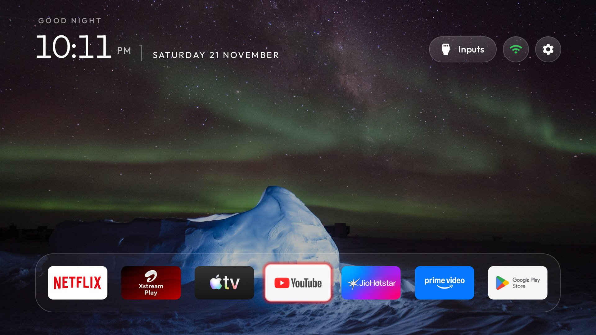
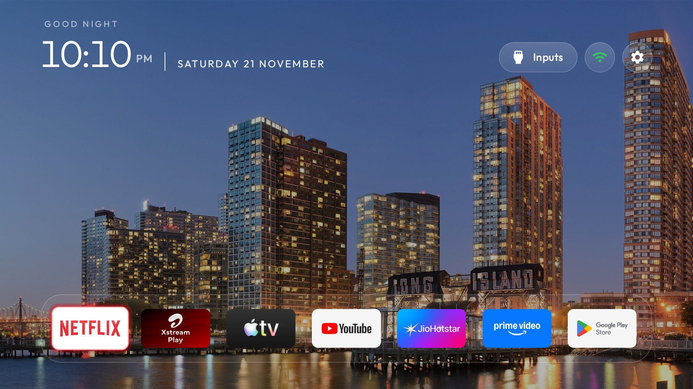
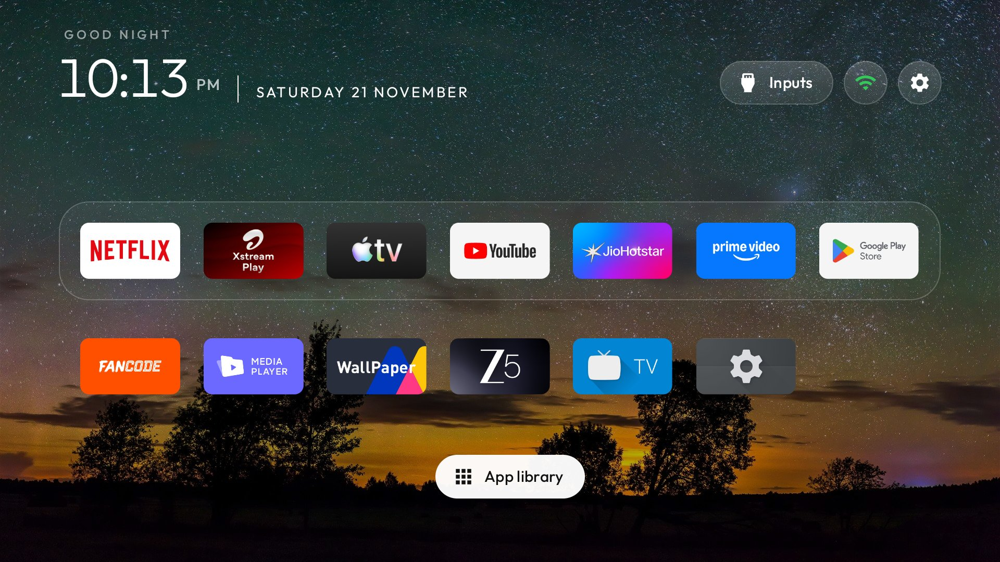

<h1 align="center">androidtv-toolkit</h1>

<p align="center">
  <b>A calmer, cleaner Android TV, with every change logged and one command away from undone.</b><br>
  De-bloated, re-skinned with a custom launcher, and documented end to end.
</p>

<p align="center">
  
</p>

<p align="center">
  
  
  
  
</p>

---

## What this is

My working repo for taking an ad-filled Android TV and making it a pleasure to use: strip the promo and
telemetry apps, swap the stock home screen for a custom launcher, and theme it. The rule from the first command was
**nothing happens that I can't undo**, so every change is written to [`RESTORE.md`](RESTORE.md) with its restore
command *before* it is applied.

It is built on top of the excellent open-source [CleanYourTV](https://github.com/Gathin23/cleanyourtv) by
Gathin (MIT). That project is the engine; this repo is what I did with it on one real TV, plus the small
changes I made to its launcher. See [What I changed](#what-i-changed-from-the-original) below.

## Before and after

| | |
|---|---|
| Stock home | Promo rows, sponsored tiles, partner apps pre-installed, several duplicate streaming apps, telemetry running in the background |
| This setup | A quiet home: seven pinned apps, a clock, a Wi-Fi status icon, and a rotating wallpaper. Nothing sponsored. |

<p align="center">
  
  
</p>

## What I changed from the original

The upstream project is a general tool for hundreds of TVs. This repo narrows it to one TV and goes further on the
look. Here is everything that differs.

| Area | Upstream CleanYourTV | This repo |
|---|---|---|
| **Scope** | Tool and launcher for many TV models | One TV, documented in depth ([`devices/`](devices/MiTV-AXSO2.md)) |
| **Process** | Run the debloat list | Back up the package list first, then log every change **with its restore command, before applying it** ([`RESTORE.md`](RESTORE.md)) |
| **Debloat** | Generic example list for this model | Reviewed app by app with the owner: 22 packages disabled, 9 apps uninstalled, 2 system apps removed for the user, voice assistant and Chromecast deliberately kept |
| **Dock** | 4 apps | 7 apps: Netflix, Airtel Xstream, YouTube, Hotstar, Prime Video, Apple TV, Play Store |
| **Grid** | 4 columns | 7 columns |
| **Theme** | Bundled examples | A new theme, [`my-ambient-glass`](themes/my-ambient-glass): glass dock, 34 rotating wallpapers, dimmed for readability |
| **Wallpapers** | None shipped | 19 licensed photos + 15 generated gradients, shuffled every minute |
| **Wi-Fi icon** | White | Green online, orange connected-but-no-internet, red offline |
| **Launcher code** | Upstream | 2 small code changes + 1 build tweak ([`patches/`](patches/launcher-changes.patch)) |

### The launcher code changes

Everything visual is a theme setting (no rebuild). Two things needed real code, so they live in a patch:

1. **The dock sits lower, so the next row doesn't peek in.** With `rows_below_dock: 0` the launcher reserves
   a strip under the dock, and the top of the second row showed in it. The patch pushes the dock down by exactly that
   reserved space. It is derived from the screen height and density rather than a hard-coded number, so it should
   hold on other TVs; on a very short screen it stops 8 dp short of the bottom edge instead of running off it.
   The second row appears when you press Down. (Tested on a 1080p TV only.)
2. **The big app name takes the app's own colour.** Focus Netflix and the name above the dock is Netflix red; Prime
   is blue. The colour is lifted 35% toward white to stay readable, and the font is Outfit Extra Light.

Plus a build tweak: the Gradle download timeout went from 10 s to 10 min, because the wrapper kept timing out on a
slow connection.

### The theme: `my-ambient-glass`

A theme is just a `config.json` and a folder of wallpapers, pushed to the TV over `adb`. No rebuild, and one
command removes it.

| Setting | Value | Why |
|---|---|---|
| `dock_glass`, `dock_opacity` | on, 40 | A frosted dock that lets the wallpaper show through |
| `wallpaper_rotation_minutes`, `wallpaper_order` | 1, `shuffle` | A different picture every minute, never the same twice in a row |
| `wallpaper_dim` | 30 | Keeps the white clock and buttons readable on bright photos |
| `app_glow`, `focus_overshoot`, `fade_rows` | on | Small touches that make focus feel alive |
| `ambient_glow` | off | Lets the wallpapers' own colours show instead of tinting them with the app colour |
| `advanced_effects` | off | Tried it. On this 2 GB TV the frame stats were borderline, so I left it off |
| `show_stats`, `dock_title` | off | A quieter header |
| `wifi_status_color`, `wifi_status_warnings` | on | Green, orange and red Wi-Fi icon |

The wallpapers are 1920x1080 JPEGs, about 11 MB in total. The photos are from Wikimedia Commons featured pictures
(attribution in [`wallpapers/CREDITS.md`](themes/my-ambient-glass/wallpapers/CREDITS.md)); the gradients are
generated, dark and smooth, in fifteen palettes.

## The debloat

All of it is in [`RESTORE.md`](RESTORE.md), grouped, each row with the exact command to undo it. In short:

- **Disabled** with `pm disable-user` (22): telemetry, the promo and PatchWall layer, preloads, and mirroring services.
  Disabling, not uninstalling, is what keeps the stock build recoverable.
- **Uninstalled**, after asking (9): duplicate and partner copies of streaming apps, an IPTV app, an ANT+ plugin.
- **Removed for the user, restorable** (2): Play Movies & TV and Play Games (`pm install-existing` brings them back).
- **Kept on purpose:** the voice assistant, Chromecast, Google sign-in, firmware updates, and the streaming apps in use.

## Safety rules

Written down in the [project rules](CLAUDE.md) and followed throughout:

1. Prefer `pm disable-user`. Uninstall only with explicit approval.
2. Take a package-list backup before changing anything.
3. Record the restore command for every change, in [`RESTORE.md`](RESTORE.md), before applying it.
4. Show each command first and wait for approval before installs or system changes.
5. Never commit APKs, keystores, ADB keys, or backups that contain the TV's IP address (see [`.gitignore`](.gitignore)).

## Reproduce it

You need `adb` (Android platform-tools), `git`, and JDK 17 plus the Android SDK if you want to build the launcher.

```powershell
# 1. Get the upstream project and apply the launcher patch
git clone https://github.com/Gathin23/cleanyourtv
cd cleanyourtv
git apply ..\androidtv-toolkit\patches\launcher-changes.patch

# 2. Build the launcher and install it (the TV needs network debugging on)
.\launcher\build-and-install.ps1 -TvHost <tv-ip>

# 3. Push the theme (no rebuild needed for theme changes)
.\tools\theme.ps1 -TvHost <tv-ip> ..\androidtv-toolkit\themes\my-ambient-glass

# Undo the theme any time
.\tools\theme.ps1 -TvHost <tv-ip> -Reset
```

Your own TV will have different package names. Start from the upstream per-device lists and review them yourself
before disabling anything; [`devices/MiTV-AXSO2.md`](devices/MiTV-AXSO2.md) shows the shape of a device note.

> `<tv-ip>` is a placeholder. No device address, serial or key is stored in this repo.

## Credits and licences

- **[CleanYourTV](https://github.com/Gathin23/cleanyourtv)** by Gathin: the debloat tooling and the launcher this is
  built on. MIT. See [`NOTICE`](NOTICE).
- **Wallpaper photos:** Wikimedia Commons contributors, under CC BY, CC BY-SA or CC0 as listed in
  [`CREDITS.md`](themes/my-ambient-glass/wallpapers/CREDITS.md). Those files keep their own licences; the MIT
  licence covers my own text, scripts and settings, not the photographs.
- **Everything else in this repo:** [MIT](LICENSE).

---

<sub>Built over one long evening, reviewing and approving every
change by hand. Not affiliated with Xiaomi, Google, or the CleanYourTV project.</sub>
